<h1 align="center">Hi, I'm Edvinas 👋</h1>

  

🇱🇹 Lithuania · 🎓 VU Software Engineering student · 🛠️ building things with audio, AI & blockchains

---

### 🚀 What I'm working on

- 🔗 **[lodestar-eip8321](https://github.com/edva-code/lodestar-eip8321)**: EIP-8321 (Hash-Chain RANDAO) in the Lodestar Ethereum consensus client. BLS RANDAO reveals replaced with BLAKE3 hash chains.
- 🎸 **[Bassova](https://github.com/edva-code/Bassova)**: turns music (recorded, eventually live) into bass tabs and sheet music.
- 🗣️ **[live-translator](https://github.com/edva-code/live-translator)** / **[parakeet-live](https://github.com/edva-code/parakeet-live)**: real-time speech experiments.
- 🤖 **[ai-agent-pr-checker](https://github.com/edva-code/ai-agent-pr-checker)**: an AI agent that reviews pull requests.

### 🧰 Tech I use

  

### 📊 Stats

  
  

### 📫 Reach me

